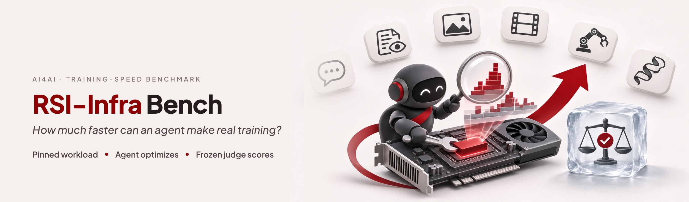
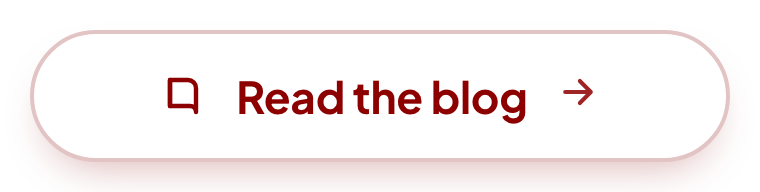
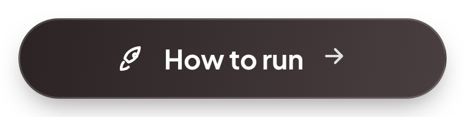
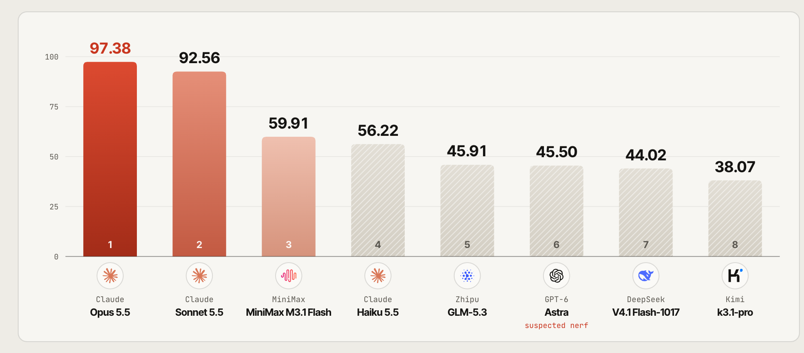
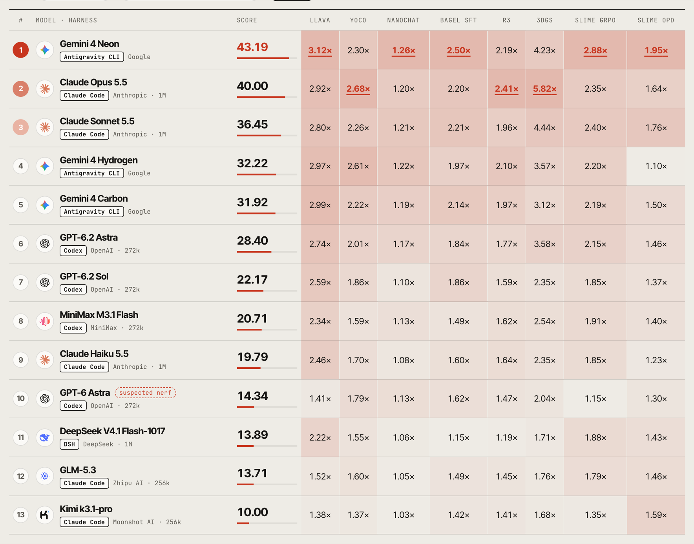
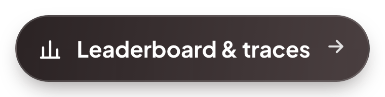
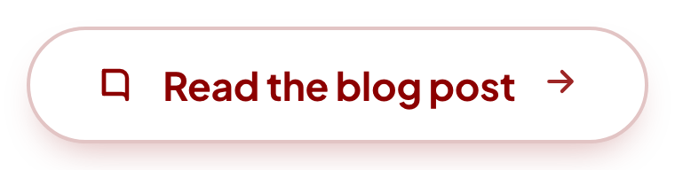

<div align="center">

<a href="https://github.com/DAGroup-PKU/ResearchBoost-Agent"></a>

<h3>Eight training-speed tasks for coding agents on Harbor,<br>scored by a frozen judge that accepts only the same training, faster</h3>

<p>
<a href="#leaderboard"></a>
<a href="https://ai4ai-for-anything.github.io/blog/rsi-infra-bench/"></a>
<a href="#how-to-run"></a>
<a href="https://github.com/DAGroup-PKU/ResearchBoost-Agent/tree/main"></a>
</p>

<p>
<a href="https://ai4ai-for-anything.github.io/blog/rsi-infra-bench/leaderboard/index.html"></a>
<a href="docs/eval-protocol.md"></a>
<a href="https://pypi.org/project/harbor/0.24.0/"></a>
<a href="docs/how-to-run.md#hardware"></a>
<a href="https://github.com/DAGroup-PKU/ResearchBoost-Agent"></a>
<a href="https://discord.gg/5k7Rr9hut"></a>
</p>

</div>

<br>

## LeaderBoard

### 8 training-optimization tasks · 10 hours per task

#### Overall



#### Per-Task



Final judged speedups against each task’s baseline.

<p align="center">
<a href="https://ai4ai-for-anything.github.io/blog/rsi-infra-bench/leaderboard/index.html"></a>
<a href="https://ai4ai-for-anything.github.io/blog/rsi-infra-bench/#analysis"></a>
</p>

<sub>\* GPT-6 Astra: suspected nerf; it feels different from our early testing.
GPT-6.2 Astra (18 November) and GPT-6.2 Sol (19 November) joined with the same setup (Codex, reasoning effort max, 10 hours).
Scores come from an ECI fit over all models together, so every rank is dynamic:
each new model refits the scale, and the scores and ranks of the others can move.</sub>

## Eval Protocol

Each agent optimizes a fixed training workload on the same GPUs.
A frozen judge verifies correctness and measures the final speedup.

- **Correctness:** bitwise identity or statistical equivalence,
  depending on the task.
- **Timing:** startup and warmup are excluded; the judge measures
  the task’s fixed workload.
- **Score:** an ECI-style fit of the eight normalized log-speedups,
  anchored at Claude Opus 5.5 = 40 and Kimi k3.1-pro = 10.

[Tasks, numerical checks and scoring details →](docs/eval-protocol.md)

## How To Run

Requires Linux, Docker with NVIDIA GPU support, and the task’s
specified Hopper GPUs.

1. Clone the benchmark and install Harbor:

   ```bash
   git clone --branch bench --single-branch \
     https://github.com/DAGroup-PKU/ResearchBoost-Agent.git RSI-Infra-Bench
   cd RSI-Infra-Bench
   pip install harbor==0.24.0
   cp researchboost.env.example researchboost.env
   ```

2. Configure the environment and prepare the task’s assets
   following the [setup guide](docs/how-to-run.md).

3. Run one task:

   ```bash
   harbor run -p tasks -i llava --env-file researchboost.env \
     -a <agent> -m <model> -n 1
   harbor view ./jobs
   ```

[GPU requirements, assets and build instructions →](docs/how-to-run.md)

## Citation

```bibtex
@misc{researchBoost_Agent_Team_RSI_Infra_Bench_2026,
  author = {{researchBoost-Agent Team}},
  title = {{RSI-Infra Bench Preview}},
  url = {https://ai4ai-for-anything.github.io/blog/rsi-infra-bench/},
  year = {2026}
}
```
