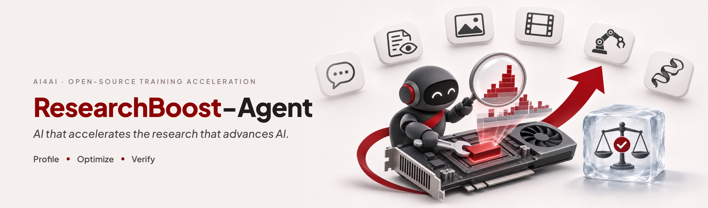
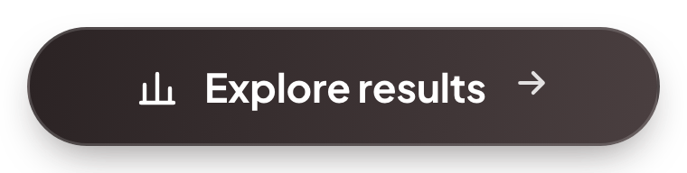
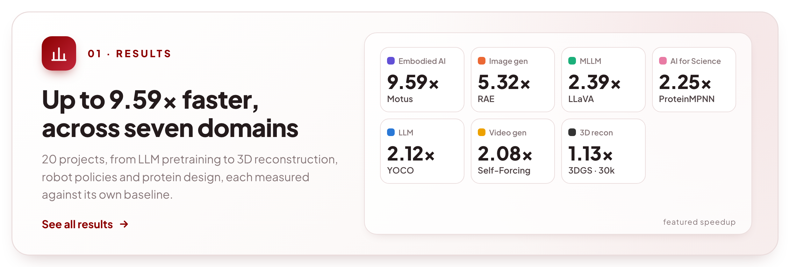
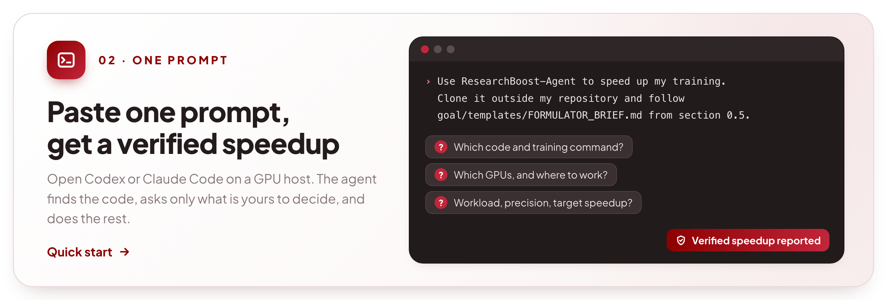
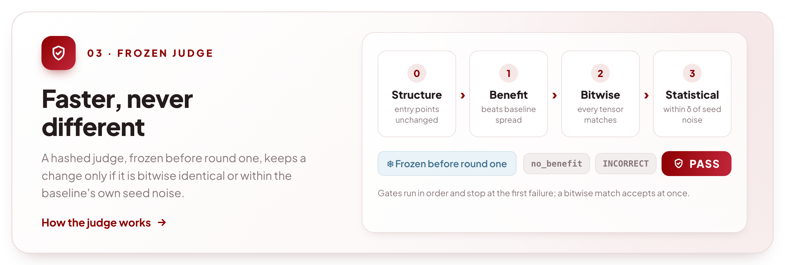
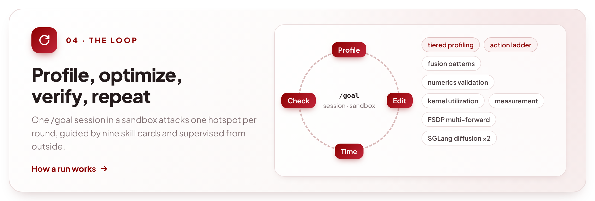
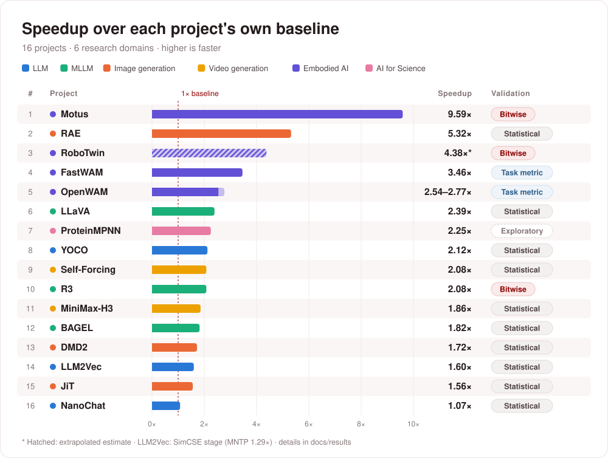
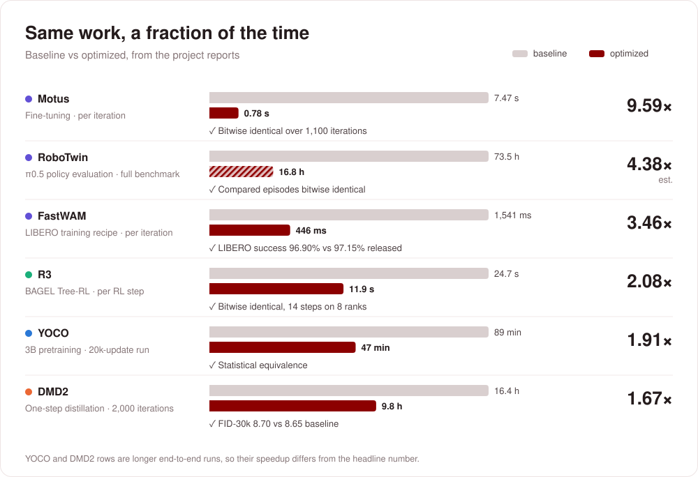
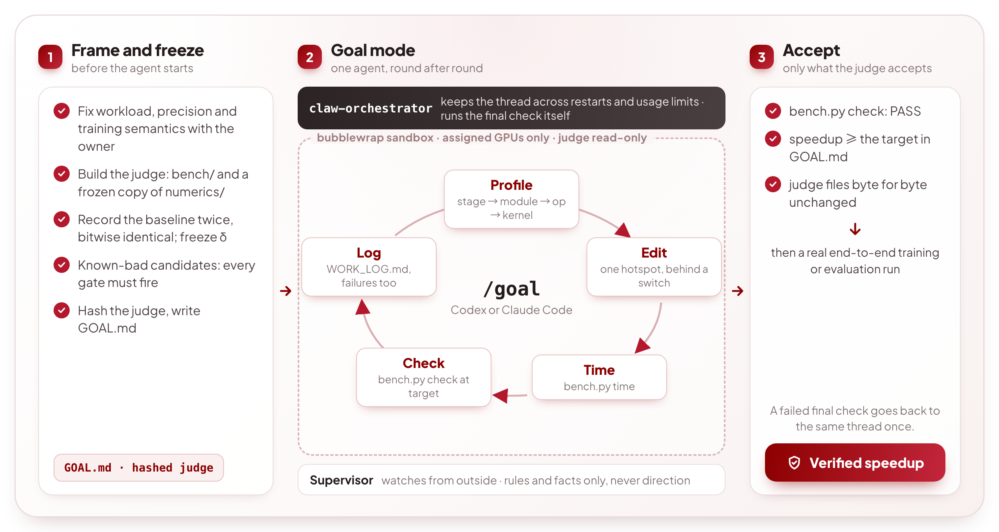
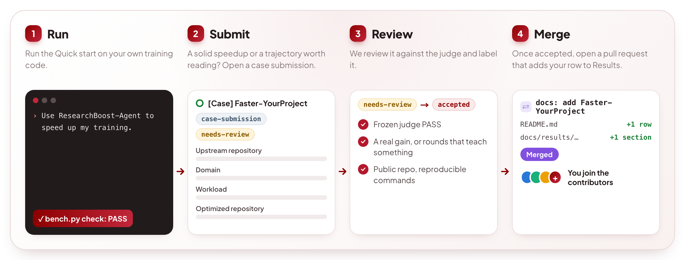

<div align="center">

<a href="https://ydove0324.github.io/hx_resume/blog/researchboost/"></a>

<h3>The open-source agent that makes AI training code faster,<br>and keeps only the speedups a frozen judge verifies</h3>

<p>
<a href="https://ydove0324.github.io/hx_resume/blog/researchboost/"></a>
<a href="#results"></a>
<a href="#quick-start"></a>
</p>

<p>
<a href="https://ai4ai-for-anything.github.io/#research"></a>
<a href="https://ydove0324.github.io/hx_resume/blog/researchboost/"></a>
<a href="https://ydove0324.github.io/hx_resume/blog/researchboost/#wishlist"></a>
<a href="https://github.com/DAGroup-PKU/ResearchBoost-Agent"></a>
<a href="https://discord.gg/5k7Rr9hut"></a>
<a href="#community"></a>
</p>

<b>English</b> · <a href="README.zh-CN.md">简体中文</a>

</div>

<br>

**Same GPUs, same training semantics: how much faster can the research loop run?** ResearchBoost-Agent turns AI capabilities into faster AI experimentation, starting with the training code researchers run every day. It autonomously profiles bottlenecks, implements optimizations, and validates speedups against a frozen evaluation protocol, turning the same compute budget into more room to explore. Have a project you want accelerated? [Submit it to the Wishlist](https://ydove0324.github.io/hx_resume/blog/researchboost/#wishlist).

## News

-  **2026-11-07** · **[Original 3DGS and PIDG](docs/results/3d-reconstruction.md)** by [@HaoqinHong](https://github.com/HaoqinHong): **1.13×** across three complete 3DGS pipelines and **4.17×** for the PIDG optical-flow module group on one A800.
-  **2026-11-07** · **[Faster-Protenix](https://github.com/micky-li-hd/Faster-Protenix)** by [@micky-li-hd](https://github.com/micky-li-hd): **1.55×** on Protenix 2.0.0 training over a fixed 128-update workload, validated by manual review.
-  **2026-11-06** · **[Faster-FermiNet](https://github.com/sen-ye/faster-ferminet)** by [@sen-ye](https://github.com/sen-ye): **1.25×** on FermiNet all-electron training for Fe, Kr, Cd and Xe.
-  **2026-11-05** · Lite check: the statistical gate now runs on one seed within 3σ, and the agent's `check` times the candidate once against the frozen baseline, leaving baseline → candidate → baseline timing to the final check. Each check takes less time, so more of a run goes to optimizing ([check modes](docs/judge.md#check-modes)).
-  **2026-11-05** · **[OpenWAM](https://github.com/OpenWAM-Official/OpenWAM)** merged RBA's training speedups upstream ([OpenWAM#58](https://github.com/OpenWAM-Official/OpenWAM/pull/58), by [@GONGSHUKAI](https://github.com/GONGSHUKAI)): **2.54–2.77×** on OpenWAM-α fine-tuning across seven SFT benchmarks.
-  **2026-11-01** · New skill card [`kernel-utilization-analysis`](skills/kernel-utilization-analysis): SM coverage, launch-bound kernels and bandwidth against peak become a standard profiling step ([#8](https://github.com/DAGroup-PKU/ResearchBoost-Agent/pull/8)).
-  **2026-11-01** · **[Faster-ProteinMPNN](https://github.com/micky-li-hd/Faster-ProteinMPNN)** by [@micky-li-hd](https://github.com/micky-li-hd): **2.25×** on ProteinMPNN training, our first AI for Science case.
-  **2026-10-30** · **[Faster-MiniMax-H3](https://github.com/2018cx/Faster-MiniMax-H3)** by [@2018cx](https://github.com/2018cx): **1.86×** on MiniMax-H3 LoRA fine-tuning.
-  **2026-10-30** · Large-model support: the numerics recorder frees each step's tensors, the sandbox binds shared paths read-only, and runs can be detached ([#6](https://github.com/DAGroup-PKU/ResearchBoost-Agent/pull/6)).
-  **2026-10-29** · **[Faster-NanoChat](https://github.com/AI4AI-for-Anything/Faster-NanoChat)** and **[Faster-LLM2Vec](https://github.com/AI4AI-for-Anything/Faster-LLM2Vec)** by [@Bool1020](https://github.com/Bool1020). Case submissions are open to everyone: see [Contribute a case](#contribute-a-case).

<details>
<summary>Earlier</summary>

-  **2026-10-28** · The quick start hands the whole job to a coding agent: paste one prompt, nothing to fill in ([#4](https://github.com/DAGroup-PKU/ResearchBoost-Agent/pull/4)).
-  **2026-10-19** · ResearchBoost-Agent is open source.

</details>

## Highlights

<a href="#results"></a>

<a href="#quick-start"></a>

<a href="#the-judge"></a>

<a href="docs/goal-mode.md"></a>

## Results

<a href="https://ai4ai-for-anything.github.io/#research"></a>



Open a domain for the workloads, or the reports for experiment settings and validation results.

<details>
<summary><strong>LLM</strong> · 3 projects — NanoChat, YOCO, LLM2Vec</summary>

| Project | Workload | Speedup |
|---|---|---:|
| [Faster-NanoChat](https://github.com/AI4AI-for-Anything/Faster-NanoChat) by [@Bool1020](https://github.com/Bool1020) | D24 (~1.384B) · Tensorwise FP8 training | **1.0744×** |
| [Faster-YOCO](https://github.com/AI4AI-for-Anything/Faster-YOCO) | YOCO-3B pretraining · BF16, no FP8 | **2.12×** |
| [Faster-LLM2Vec](https://github.com/AI4AI-for-Anything/Faster-LLM2Vec) by [@Bool1020](https://github.com/Bool1020) | Mistral-7B · BF16 LoRA; MNTP / SimCSE (independent stages) | **1.2900× / 1.6009×** |

[Measurement setup & validation →](docs/results/llm.md)

</details>

<details>
<summary><strong>MLLM</strong> · 3 projects — LLaVA, BAGEL, R3</summary>

| Project | Workload | Speedup |
|---|---|---:|
| [Faster-LLaVA](https://github.com/AI4AI-for-Anything/Faster-LLaVA) | LLaVA-1.5-7B stage-2 fine-tuning | **2.39×** |
| [Faster-BAGEL](https://github.com/AI4AI-for-Anything/Faster-BAGEL) | 7B-MoT SFT · BF16 compute, no FP8 | **1.82×** |
| [Faster-R3](https://github.com/AI4AI-for-Anything/Faster-R3) | BAGEL 7B-MoT Tree-RL | **2.08×** |

[Measurement setup & validation →](docs/results/multimodal.md)

</details>

<details>
<summary><strong>Image Generation</strong> · 3 projects — RAE, DMD2, JiT</summary>

| Project | Workload | Speedup |
|---|---|---:|
| [Faster-RAE](https://github.com/AI4AI-for-Anything/Faster-RAE) | Stage-1 decoder + GAN training | **5.32×** |
| [Faster-DMD](https://github.com/AI4AI-for-Anything/Faster-DMD) | DMD2 one-step SD1.5 distillation + GAN | **1.72×** |
| [Faster-JiT](https://github.com/AI4AI-for-Anything/Faster-JiT) | JiT-B/16 · ImageNet 256 training | **1.56×** |

[Measurement setup & validation →](docs/results/image-generation.md)

</details>

<details>
<summary><strong>Video Generation</strong> · 2 projects — Self-Forcing, MiniMax-H3</summary>

| Project | Workload | Speedup |
|---|---|---:|
| [Faster-SelfForcing](https://github.com/AI4AI-for-Anything/Faster-SelfForcing) | Self-Forcing video DMD training | **2.08×** |
| [Faster-MiniMax-H3](https://github.com/2018cx/Faster-MiniMax-H3) by [@2018cx](https://github.com/2018cx) | MiniMax-H3 FL2VA · BF16 LoRA / ZeRO-3 | **1.8570×** |

[Measurement setup & validation →](docs/results/video-generation.md)

</details>

<details>
<summary><strong>Embodied AI</strong> · 4 projects — RoboTwin, Motus, FastWAM, OpenWAM</summary>

| Project | Workload | Speedup |
|---|---|---:|
| [Faster-RoboTwin](https://github.com/AI4AI-for-Anything/Faster-RoboTwin) | π0.5 policy evaluation · RoboTwin 2.0 | **4.38×** (est.) |
| [Faster-Motus](https://github.com/AI4AI-for-Anything/Faster-Motus) | RoboTwin 2.0 fine-tuning · 27,244 episodes | **9.59×** |
| [Faster-FastWAM](https://github.com/AI4AI-for-Anything/Faster-FastWAM) | FastWAM-LIBERO training recipe | **3.46×** |
| [OpenWAM](https://github.com/OpenWAM-Official/OpenWAM#training-acceleration) by [@GONGSHUKAI](https://github.com/GONGSHUKAI) | OpenWAM-α fine-tuning · seven SFT benchmarks · merged upstream | **2.54–2.77×** |

[Measurement setup & validation →](docs/results/embodied-ai.md)

</details>

<details>
<summary><strong>AI for Science</strong> · 3 projects — ProteinMPNN, Protenix, FermiNet</summary>

| Project | Workload | Speedup |
|---|---|---:|
| [Faster-ProteinMPNN](https://github.com/micky-li-hd/Faster-ProteinMPNN) by [@micky-li-hd](https://github.com/micky-li-hd) | ProteinMPNN v_48_020 training · full public dataset | **2.25×** |
| [Faster-Protenix](https://github.com/micky-li-hd/Faster-Protenix) by [@micky-li-hd](https://github.com/micky-li-hd) | Protenix 2.0.0 training · 128 updates · crop 384 | **1.55×** |
| [Faster-FermiNet](https://github.com/sen-ye/faster-ferminet) by [@sen-ye](https://github.com/sen-ye) | Fe / Kr / Cd / Xe all-electron training · KFAC, 1024 walkers per GPU | **1.25×** |

[Measurement setup & validation →](docs/results/ai4s.md)

</details>


<details>
<summary><strong>3D Reconstruction</strong> · 2 projects — Original 3DGS, PIDG</summary>

| Project | Workload | Speedup |
|---|---|---:|
| [Original 3DGS](https://github.com/HaoqinHong/Physics-Informed-Deformable-Gaussian-Splatting-ResearchBoost) by [@HaoqinHong](https://github.com/HaoqinHong) | Mip-NeRF360 · bonsai / bicycle / garden · complete 30,000-step pipelines | **1.13×** total; **1.07–1.29×** per scene |
| [PIDG](https://github.com/HaoqinHong/Physics-Informed-Deformable-Gaussian-Splatting-ResearchBoost) by [@HaoqinHong](https://github.com/HaoqinHong) | dry_ice · optical-flow module group | **4.17×** |

[Measurement setup, image quality & validation →](docs/results/3d-reconstruction.md)

</details>

[Full results index →](docs/results/README.md) · [Interactive results ↗](https://ai4ai-for-anything.github.io/#research) · [Add your case →](#contribute-a-case)

## Quick start

Open Codex or Claude Code on a Linux GPU host, in your training repository or in an empty folder, and paste:

```text
Use ResearchBoost-Agent (https://github.com/DAGroup-PKU/ResearchBoost-Agent) to speed up my training.
Clone it outside my repository and follow goal/templates/FORMULATOR_BRIEF.md from section 0.5.
```

There is nothing to fill in. The agent looks around first (the repository you opened it in, the GPUs, the free disk), then asks with its question tool, each question offering what it found: which code and training command, which GPUs, where to work; then, once it has read the code, the workload, precision and target speedup, which are your decisions. Everything else it does itself: it installs and starts [claw-orchestrator](https://github.com/Enderfga/claw-orchestrator), reuses the model access the host already has (its Codex or Claude Code login, or `OPENAI_API_KEY` / `ANTHROPIC_API_KEY`), builds and verifies the frozen judge, launches the optimizer on the same engine, supervises it, and reports the verified speedup. [bubblewrap](https://github.com/containers/bubblewrap) isolates the optimizer when the host has it; without it the run still works, guarded by the judge's hashes.

Codex shows its question form when started as `codex --enable default_mode_request_user_input`; without it the agent asks the same questions in one message.

<details>
<summary>Reproduce one of the tasks in this repository</summary>

```text
Use ResearchBoost-Agent (https://github.com/DAGroup-PKU/ResearchBoost-Agent) to reproduce its task tasks/dmd2.
Clone it and follow docs/run-a-task.md; ask me which GPUs and work directory to use, offering what you find.
```

</details>

## How it works

### A run



1. **Frame and freeze.** The owner fixes what may not change: the upstream workload and per-GPU load, the baseline precision, the training semantics. A formulating agent builds the judge for this task (`bench/` plus a frozen copy of [`numerics/`](numerics)), records the baseline twice and confirms the records are bitwise identical, freezes its seed-to-seed σ, proves with known-bad candidates that every gate fires, hashes the judge and writes `GOAL.md`. The formulation material stays out of the optimizing agent's sight; the judge itself is read-only to it.
2. **Goal mode.** One Codex or Claude Code `/goal` session gets the workspace, the assigned GPUs and the skill cards inside a bubblewrap sandbox, with the judge read-only. Every round it profiles the current best version, changes one hotspot behind a switch, measures with `bench.py time`, runs `bench.py check` once timing reaches the target, and logs the round in `WORK_LOG.md`, failed rounds included. [claw-orchestrator](https://github.com/Enderfga/claw-orchestrator) runs the session: it keeps the thread across restarts and usage limits, and when the agent stops it runs the final check itself. A supervisor watches from outside and intervenes only on rules and facts, never on optimization direction. See [docs/goal-mode.md](docs/goal-mode.md).
3. **Accept.** The final check is the only verdict: `bench.py check --final` must PASS, the speedup must reach the target in `GOAL.md`, and every judge file must be byte for byte as it was at launch. A failed final check goes back to the same thread once. A PASS is then confirmed with a real end-to-end training or evaluation run.

### The judge

A candidate counts only if the task's frozen judge accepts it. The judge runs these gates in order and stops at the first one that fails:

0. **Structure**: the training entry points the judge drives are unchanged (AST compare), data loading is bitwise identical, and exact items match: phase, call counts, RNG fingerprints, learning rate, cross-rank sync.
1. **Benefit**: the agent's own check times the candidate once against the baseline timing frozen at formulation; the harness's final check times baseline → candidate → baseline in independent processes. A speedup that does not exceed `max(1.02, 1 + 2 × baseline spread)` is rejected as no benefit; precision is not evaluated.
2. **Bitwise**: every tensor recorded in short deterministic cases matches the baseline bit for bit → accept.
3. **Statistical**: otherwise, one paired training trajectory on the first frozen seed; every endpoint's bias must stay within 3σ, σ the baseline's own seed-to-seed standard deviation, frozen before any candidate is seen.

The judge is frozen and hashed before optimization starts and is never relaxed to let a candidate through. Details: [docs/judge.md](docs/judge.md).

## Contribute a case

Got a result with ResearchBoost-Agent? Add it to [Results](#results).



1. Run the [Quick start](#quick-start) on your own training code.
2. If you get a solid speedup or a non-trivial optimization trajectory, open a [case submission](https://github.com/DAGroup-PKU/ResearchBoost-Agent/issues/new?template=case-submission.yml).
3. We review it. Once it is accepted, open a pull request that adds your result to Results, linking to your repository.
4. When the pull request is merged, you appear among this repository's contributors.

Review criteria and the pull request format: [CONTRIBUTING.md](CONTRIBUTING.md). To have us accelerate a project instead, use the [Wishlist](https://ydove0324.github.io/hx_resume/blog/researchboost/#wishlist).

## Starting a new task

The quick start does this for you. By hand: read [AGENTS.md](AGENTS.md) and [docs/methodology.md](docs/methodology.md), lay out the workspace with [`goal/init_task.sh`](goal/init_task.sh), give the formulating agent [`goal/templates/FORMULATOR_BRIEF.md`](goal/templates/FORMULATOR_BRIEF.md), and use [`tasks/dmd2`](tasks/dmd2) as the template: `GOAL.md`, a `bench/` with `check` / `time` / `profile`, a task adapter for [`numerics/`](numerics), and the prep scripts that rebuild the environment and freeze the baseline.

## Repository layout

| Path | Contents |
|---|---|
| [`docs/results/`](docs/results) | Results from 20 projects, grouped by domain, with measurement scope and validation records |
| [`docs/`](docs) | [Methodology](docs/methodology.md), [the judge](docs/judge.md), [goal mode](docs/goal-mode.md), [running a task](docs/run-a-task.md), [lessons from four tasks](docs/lessons.md) |
| [`goal/`](goal) | Running one Codex or Claude Code `/goal` session on claw-orchestrator: the task scaffold, the sandbox, model access for both engines, run / status / steer / resume scripts and the final check, the watchdog, the brief for the formulating and supervising agent |
| [`numerics/`](numerics) | The equivalence component every task judge copies and freezes: recording, bitwise and tiered comparison, paired-seed trajectories, the task adapter base class, a self-test |
| [`skills/`](skills) | Nine skill cards read before choosing what to try: `train-opt-*` (profiling, measurement, action ladder, numerics validation, fusion patterns, FSDP multi-forward), `kernel-utilization-analysis` (SM coverage, launch-bound kernels, bandwidth against peak, repeated kernel chains, with a trace-analysis script) and `sglang-diffusion-*` (diffusion benchmarking and performance) |
| [`tasks/`](tasks) | Per task: the `GOAL.md` the agent saw, the frozen judge code, archived judge records, supervision notes and the prep scripts |

## Community

<table>
<tr>
<td align="center" width="270"><br><sub>WeChat group · the QR code is refreshed weekly</sub></td>
<td valign="middle">Questions, ideas, or a run that went sideways? Join us on <a href="https://discord.gg/5k7Rr9hut">Discord</a> or scan the QR code to join the WeChat group.<br><br>Bug reports, fixes and new cases are welcome as issues or pull requests: see <a href="CONTRIBUTING.md">CONTRIBUTING.md</a>.</td>
</tr>
</table>

## Acknowledgements

We thank the [SGLang](https://github.com/sgl-project/sglang) project. Part of the kernel-optimization skills in this repository are ported from SGLang: [`skills/sglang-diffusion-benchmark-profile`](skills/sglang-diffusion-benchmark-profile) and [`skills/sglang-diffusion-performance`](skills/sglang-diffusion-performance) are adapted from the skills in [`python/sglang/multimodal_gen/.agents/skills`](https://github.com/sgl-project/sglang/tree/main/python/sglang/multimodal_gen/.agents/skills), released under the Apache-2.0 license.

We also thank [Enderfga](https://github.com/Enderfga) for [claw-orchestrator](https://github.com/Enderfga/claw-orchestrator), which powers our goal-mode session orchestration.

We thank [NextTransformer](https://github.com/Interactive-Active-AI/NextTransformer) as well, whose README inspired the layout and style of our README.

## Citation

If you use ResearchBoost-Agent in your research or project, please cite:

```bibtex
@misc{researchboost2026infra,
  author = {{ResearchBoost Team}},
  title = {{ResearchBoost}: {RSI} starts with Infra},
  year = {2026},
  url = {https://ydove0324.github.io/hx_resume/blog/researchboost/}
}
```

## 🌟 Star History

[](https://star-history.com/#AI4AI-for-Anything/ResearchBoost-Agent&Date)
