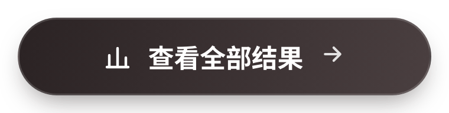
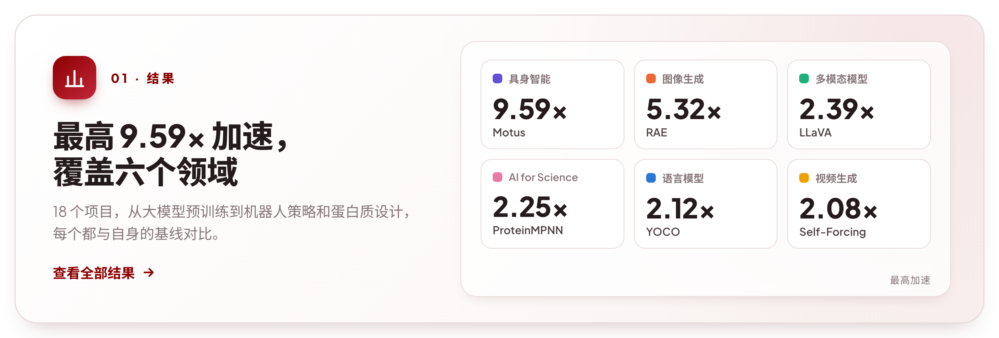
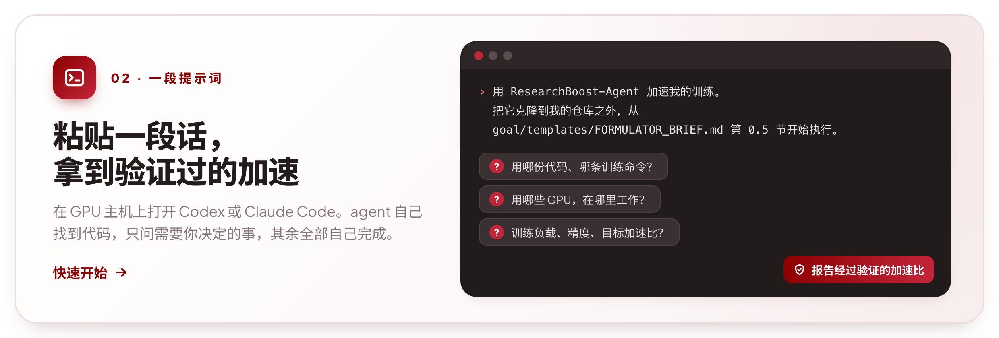
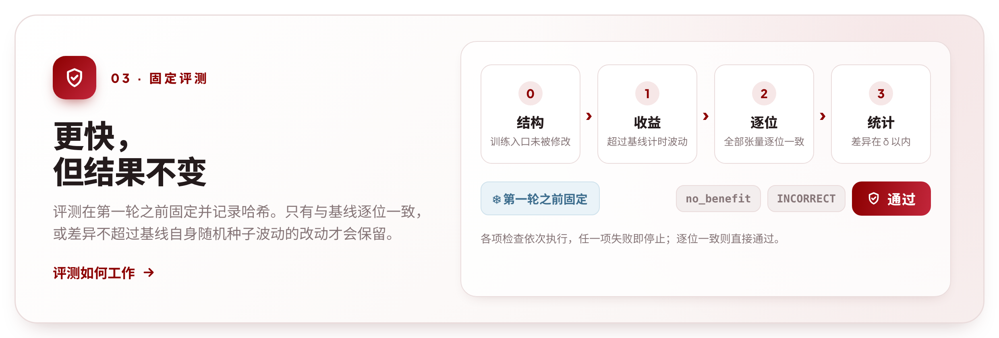
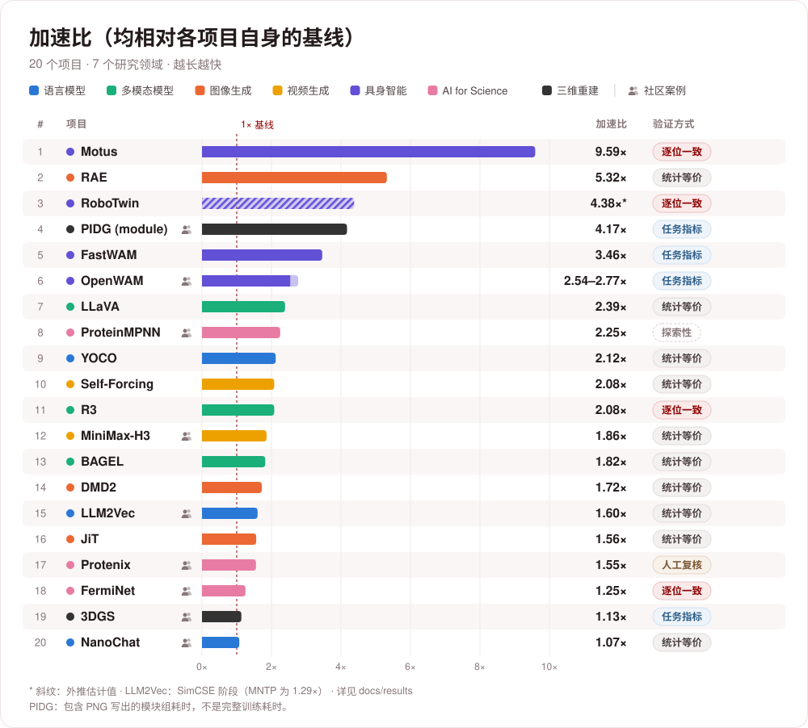
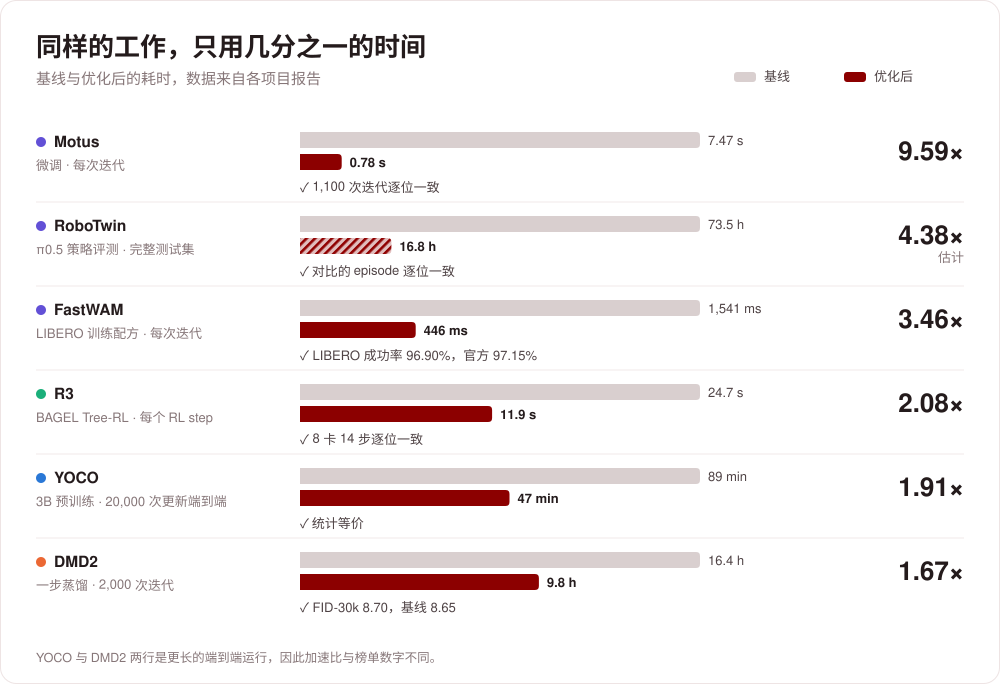
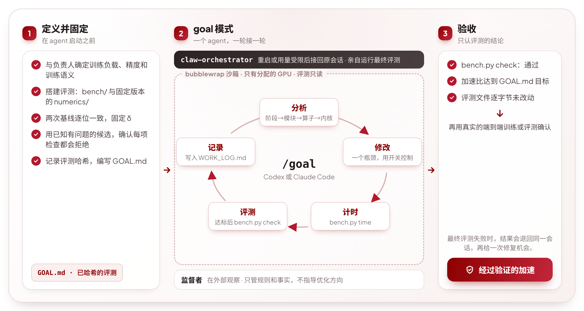
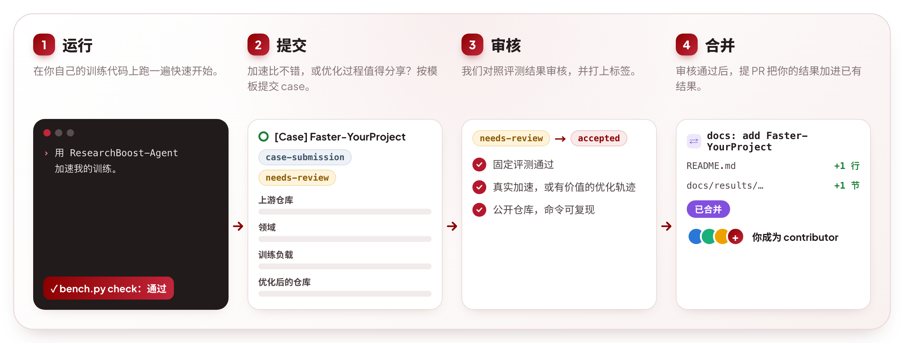

<div align="center">

<a href="https://ydove0324.github.io/hx_resume/blog/researchboost/"></a>

<h3>开源的 AI 训练加速 agent：自主分析、优化，<br>只保留通过固定评测验证的加速</h3>

<p>
<a href="https://ydove0324.github.io/hx_resume/blog/researchboost/"></a>
<a href="#已有结果"></a>
<a href="#快速开始"></a>
</p>

<p>
<a href="https://ai4ai-for-anything.github.io/#research"></a>
<a href="https://ydove0324.github.io/hx_resume/blog/researchboost/"></a>
<a href="https://ydove0324.github.io/hx_resume/blog/researchboost/#wishlist"></a>
<a href="https://github.com/DAGroup-PKU/ResearchBoost-Agent"></a>
<a href="https://discord.gg/5k7Rr9hut"></a>
<a href="#交流社区"></a>
</p>

<a href="README.md">English</a> · <b>简体中文</b>

</div>

<br>

**同样的 GPU、同样的训练语义，研究迭代还能快多少？** ResearchBoost-Agent 从研究者日常使用的训练代码入手，用 AI 加快实验迭代。它自主分析性能瓶颈、实现优化，并按照预先固定的评测规则验证加速效果，让研究者在相同算力预算下开展更多实验。有希望加速的项目？[提交到 Wishlist](https://ydove0324.github.io/hx_resume/blog/researchboost/#wishlist)。

## 动态

-  **2026-11-05** · 轻量化 check：统计检查改为单种子 3σ，agent 自己的 `check` 只计时一次候选版本、与固定的基线计时比较，“基线 → 候选版本 → 基线”计时留给最终评测。每次 check 更快，一次运行中更多时间用于优化（[check 模式](docs/judge.md#check-modes)）。
-  **2026-11-01** · 新增技能文档 [`kernel-utilization-analysis`](skills/kernel-utilization-analysis)：SM 占用、受启动开销限制的内核、实际带宽与峰值之比成为标准的性能分析步骤（[#8](https://github.com/DAGroup-PKU/ResearchBoost-Agent/pull/8)）。
-  **2026-11-01** · **[Faster-ProteinMPNN](https://github.com/micky-li-hd/Faster-ProteinMPNN)**，来自 [@micky-li-hd](https://github.com/micky-li-hd)：ProteinMPNN 训练加速 **2.25×**，第一个 AI for Science 案例。
-  **2026-10-30** · **[Faster-MiniMax-H3](https://github.com/2018cx/Faster-MiniMax-H3)**，来自 [@2018cx](https://github.com/2018cx)：MiniMax-H3 LoRA 微调加速 **1.86×**。
-  **2026-10-30** · 大模型支持：数值记录器逐步释放张量，沙箱可把共享路径设为只读，并支持后台运行（[#6](https://github.com/DAGroup-PKU/ResearchBoost-Agent/pull/6)）。
-  **2026-10-29** · **[Faster-NanoChat](https://github.com/AI4AI-for-Anything/Faster-NanoChat)** 和 **[Faster-LLM2Vec](https://github.com/AI4AI-for-Anything/Faster-LLM2Vec)**，来自 [@Bool1020](https://github.com/Bool1020)。案例提交向所有人开放，见[贡献案例](#贡献案例)。

<details>
<summary>更早</summary>

-  **2026-10-28** · 快速开始把整个流程交给编程 agent：粘贴一段话即可，无需填写任何内容（[#4](https://github.com/DAGroup-PKU/ResearchBoost-Agent/pull/4)）。
-  **2026-10-19** · ResearchBoost-Agent 开源。

</details>

## 亮点

<a href="#已有结果"></a>

<a href="#快速开始"></a>

<a href="#评测"></a>

<a href="docs/goal-mode.md"></a>

## 已有结果

<a href="https://ai4ai-for-anything.github.io/#research"></a>



展开各领域可查看任务负载，实验设置与验证结果见分类报告。

<details>
<summary><strong>语言模型</strong> · 3 个项目 — NanoChat, YOCO, LLM2Vec</summary>

| 项目 | 工作负载 | 加速比 |
|---|---|---:|
| [Faster-NanoChat](https://github.com/AI4AI-for-Anything/Faster-NanoChat)（[@Bool1020](https://github.com/Bool1020) 贡献） | D24 预训练（Tensorwise FP8） | **1.0744×** |
| [Faster-YOCO](https://github.com/AI4AI-for-Anything/Faster-YOCO) | YOCO-3B 预训练 | **2.12×** |
| [Faster-LLM2Vec](https://github.com/AI4AI-for-Anything/Faster-LLM2Vec)（[@Bool1020](https://github.com/Bool1020) 贡献） | Mistral-7B · BF16 LoRA；MNTP / SimCSE（独立阶段） | **1.2900× / 1.6009×** |

[实验设置与验证记录（英文） →](docs/results/llm.md)

</details>

<details>
<summary><strong>多模态模型</strong> · 3 个项目 — LLaVA, BAGEL, R3</summary>

| 项目 | 工作负载 | 加速比 |
|---|---|---:|
| [Faster-LLaVA](https://github.com/AI4AI-for-Anything/Faster-LLaVA) | LLaVA-1.5-7B 第二阶段微调 | **2.39×** |
| [Faster-BAGEL](https://github.com/AI4AI-for-Anything/Faster-BAGEL) | BAGEL-7B-MoT 监督微调 | **1.82×** |
| [Faster-R3](https://github.com/AI4AI-for-Anything/Faster-R3) | BAGEL-7B-MoT Tree-RL | **2.08×** |

[实验设置与验证记录（英文） →](docs/results/multimodal.md)

</details>

<details>
<summary><strong>图像生成</strong> · 3 个项目 — RAE, DMD2, JiT</summary>

| 项目 | 工作负载 | 加速比 |
|---|---|---:|
| [Faster-RAE](https://github.com/AI4AI-for-Anything/Faster-RAE) | Stage-1 解码器 + GAN 训练 | **5.32×** |
| [Faster-DMD](https://github.com/AI4AI-for-Anything/Faster-DMD) | SD1.5 一步蒸馏 + GAN | **1.72×** |
| [Faster-JiT](https://github.com/AI4AI-for-Anything/Faster-JiT) | JiT-B/16 ImageNet 256 训练 | **1.56×** |

[实验设置与验证记录（英文） →](docs/results/image-generation.md)

</details>

<details>
<summary><strong>视频生成</strong> · 2 个项目 — Self-Forcing, MiniMax-H3</summary>

| 项目 | 工作负载 | 加速比 |
|---|---|---:|
| [Faster-SelfForcing](https://github.com/AI4AI-for-Anything/Faster-SelfForcing) | 视频 DMD 训练 | **2.08×** |
| [Faster-MiniMax-H3](https://github.com/2018cx/Faster-MiniMax-H3)（[@2018cx](https://github.com/2018cx) 贡献） | MiniMax-H3 FL2VA · BF16 LoRA / ZeRO-3 | **1.8570×** |

[实验设置与验证记录（英文） →](docs/results/video-generation.md)

</details>

<details>
<summary><strong>具身智能</strong> · 3 个项目 — RoboTwin, Motus, FastWAM</summary>

| 项目 | 工作负载 | 加速比 |
|---|---|---:|
| [Faster-RoboTwin](https://github.com/AI4AI-for-Anything/Faster-RoboTwin) | RoboTwin 2.0 π0.5 策略评测 | **4.38×**（估算） |
| [Faster-Motus](https://github.com/AI4AI-for-Anything/Faster-Motus) | RoboTwin 2.0 微调 | **9.59×** |
| [Faster-FastWAM](https://github.com/AI4AI-for-Anything/Faster-FastWAM) | FastWAM-LIBERO 训练 | **3.46×** |

[实验设置与验证记录（英文） →](docs/results/embodied-ai.md)

</details>

<details>
<summary><strong>AI for Science</strong> · 1 个项目 — ProteinMPNN</summary>

| 项目 | 工作负载 | 加速比 |
|---|---|---:|
| [Faster-ProteinMPNN](https://github.com/micky-li-hd/Faster-ProteinMPNN)（[@micky-li-hd](https://github.com/micky-li-hd) 贡献） | ProteinMPNN v_48_020 训练（完整公开数据集） | **2.25×** |

[实验设置与验证记录（英文） →](docs/results/ai4s.md)

</details>


[完整结果索引（英文） →](docs/results/README.md) · [交互式官网 ↗](https://ai4ai-for-anything.github.io/#research) · [贡献你的结果 →](#贡献案例)

## 快速开始

在 Linux GPU 主机上打开 Codex 或 Claude Code（在你的训练仓库里，或者一个空文件夹里都行），粘贴：

```text
用 ResearchBoost-Agent（https://github.com/DAGroup-PKU/ResearchBoost-Agent）加速我的训练。
把它克隆到我的仓库之外，从 goal/templates/FORMULATOR_BRIEF.md 第 0.5 节开始执行。
```

不需要填写任何内容。agent 会先查看环境（当前打开的仓库、GPU、磁盘剩余空间），再用它的提问工具逐项询问，每个问题都把查到的情况列成选项：用哪份代码和哪条训练命令、用哪些 GPU、在哪里工作；读完代码后，再询问训练负载、数值精度和目标加速比，这些由你决定。其余工作 agent 自己完成：安装并启动 [claw-orchestrator](https://github.com/Enderfga/claw-orchestrator)，沿用主机上已有的模型访问方式（Codex 或 Claude Code 的登录，或环境变量里的 `OPENAI_API_KEY` / `ANTHROPIC_API_KEY`），搭建并验证固定的评测程序，用同一个引擎启动优化，监督到结束，最后报告经过验证的加速比。主机装有 [bubblewrap](https://github.com/containers/bubblewrap) 时用它隔离负责优化的 agent；没有时也能运行，评测程序由哈希校验保护。

Codex 用 `codex --enable default_mode_request_user_input` 启动时会弹出提问表单；不加这个参数时，agent 会在一条消息里问同样的问题。

<details>
<summary>复现本仓库中的任务</summary>

```text
用 ResearchBoost-Agent（https://github.com/DAGroup-PKU/ResearchBoost-Agent）复现它的任务 tasks/dmd2。
克隆它，按 docs/run-a-task.md 执行；用哪些 GPU、在哪个工作目录，先查看主机情况再列出选项问我。
```

</details>

## 工作原理

### 运行流程



1. **定义并固定。** 任务负责人先明确必须保持不变的设置：上游训练工作负载、每张 GPU 的负载、基线数值精度和训练计算逻辑。负责准备任务的 agent 搭建评测程序（`bench/` 和一份固定版本的 [`numerics/`](numerics)），记录两次基线并确认逐位一致，固定基线在不同随机种子之间的标准差 σ，用已知有问题的候选版本验证各项检查都能拒绝错误，然后记录评测哈希、编写 `GOAL.md`。准备过程的材料对负责优化的 agent 不可见，评测本身对它只读。
2. **goal 模式。** 在 bubblewrap 沙箱内，为一个 Codex 或 Claude Code 的 `/goal` 会话提供工作区、分配的 GPU 和技能文档，评测目录只读。每轮先分析当前最佳版本的性能，再优化一个瓶颈，并用配置开关控制是否启用；用 `bench.py time` 计时，达到目标后运行 `bench.py check`，最后把本轮结果（包括失败的轮次）写入 `WORK_LOG.md`。会话由 [claw-orchestrator](https://github.com/Enderfga/claw-orchestrator) 运行：主机重启或模型接口达到用量上限后，它会接回同一个会话继续；agent 停下后，由它亲自运行最终评测。监督者在沙箱外观察，只针对规则执行和事实核对进行干预，不指导优化方向。详见 [docs/goal-mode.md](docs/goal-mode.md)。
3. **验收。** 最终评测是唯一的结论：`bench.py check --final` 必须通过，加速比必须达到 `GOAL.md` 中的目标，所有评测文件必须与启动时逐字节一致。最终评测失败时，结果会退回同一会话，再给一次修复机会。通过后，再用实际的端到端训练或评测确认结果。

### 评测

候选版本必须通过预先固定的评测。评测依次执行以下检查；某项检查失败后，不再继续：

0. **结构检查**：通过 AST 比对确认评测所调用的训练入口未被修改；数据加载结果逐位一致；训练阶段、调用次数、随机数状态指纹、学习率和跨进程同步等要求精确匹配的项目全部一致。
1. **性能检查**：agent 自己运行的检查只计时一次候选版本，与任务准备时固定的基线计时比较；最终检查由 harness 运行，按“基线 → 候选版本 → 基线”的顺序在独立进程中分别计时。加速比若不超过 `max(1.02, 1 + 2 × 基线计时的相对差异)`，则判定为无性能收益（`no_benefit`），不再进行数值精度检查。
2. **逐位一致性检查**：在确定性的短序列测试中，如果记录的全部张量与基线逐位一致，则通过评测。
3. **统计检查**：如果未达到逐位一致，则用第一个固定的随机种子各跑一条基线和候选版本的配对训练轨迹。每个终点指标与基线的偏差必须在 3σ 以内，σ 是基线在不同随机种子下该指标的标准差，在评测任何候选版本之前固定。

评测程序在优化开始前固定，并记录哈希用于校验，后续不因候选结果而放宽评测规则。详见 [docs/judge.md](docs/judge.md)。

## 贡献案例

用 ResearchBoost-Agent 跑出了结果？欢迎加入[已有结果](#已有结果)。



1. 在你自己的训练代码上跑一遍[快速开始](#快速开始)。
2. 如果加速比不错，或者优化过程有值得分享的轨迹，按 [case 提交模板](https://github.com/DAGroup-PKU/ResearchBoost-Agent/issues/new?template=case-submission.yml)开一个 issue（表单为英文）。
3. 审核通过后，提一个 pull request，把结果加进已有结果，链接到你自己的仓库。
4. PR 合并后，你会出现在本仓库的 contributors 中。

审核标准和 PR 格式见 [CONTRIBUTING.md](CONTRIBUTING.md)（英文）。如果是希望我们帮你加速某个项目，请提交到 [Wishlist](https://ydove0324.github.io/hx_resume/blog/researchboost/#wishlist)。

## 创建新任务

快速开始中的那段话会让 agent 完成这些工作。手动操作时：先阅读 [AGENTS.md](AGENTS.md) 和 [docs/methodology.md](docs/methodology.md)，用 [`goal/init_task.sh`](goal/init_task.sh) 建好任务目录，再将 [`goal/templates/FORMULATOR_BRIEF.md`](goal/templates/FORMULATOR_BRIEF.md) 交给负责准备任务的 agent。以 [`tasks/dmd2`](tasks/dmd2) 为模板，准备任务说明 `GOAL.md`、提供 `check` / `time` / `profile` 命令的评测目录 `bench/`、对接 [`numerics/`](numerics) 的任务适配器，以及用于重建环境和固定基线的准备脚本。

## 目录

| 路径 | 内容 |
|---|---|
| [`docs/results/`](docs/results) | 15 个项目的分类报告、测量范围与验证记录（英文） |
| [`docs/`](docs) | 英文文档：[方法](docs/methodology.md)、[评测](docs/judge.md)、[goal 模式](docs/goal-mode.md)、[任务运行指南](docs/run-a-task.md)、[四个任务的经验](docs/lessons.md) |
| [`goal/`](goal) | 在 claw-orchestrator 上运行 Codex 或 Claude Code `/goal` 会话的工具：建任务目录的脚本、沙箱、两种引擎的模型访问配置、启动 / 查看状态 / 发送提醒 / 恢复运行的脚本和最终评测、监控脚本，以及任务准备和监督 agent 的说明 |
| [`numerics/`](numerics) | 各任务评测复制并固定版本的数值等价性检查组件：数据记录、逐位和分级比对、配对随机种子的训练轨迹比对、任务适配器基类及自测 |
| [`skills/`](skills) | 选择优化方向前阅读的 9 份技能文档：`train-opt-*`（性能分析、计时、分阶段优化步骤、数值验证、算子融合方法、FSDP 多次前向计算）、`kernel-utilization-analysis`（SM 占用、受启动开销限制的内核、实际带宽与峰值之比、重复出现的小内核链，附 trace 分析脚本）和 `sglang-diffusion-*`（扩散模型的性能测试与优化方法） |
| [`tasks/`](tasks) | 各任务的材料：agent 使用的 `GOAL.md`、固定版本的评测代码、评测结果存档、监督记录和准备脚本 |

## 交流社区

<table>
<tr>
<td align="center" width="270"><br><sub>微信群 · 二维码每周更新</sub></td>
<td valign="middle">有问题、想法，或者运行遇到了意外？欢迎加入 <a href="https://discord.gg/5k7Rr9hut">Discord</a>，或扫码加入微信群。<br><br>也欢迎通过 issue 或 pull request 报告问题、提交修复和新案例，见 <a href="CONTRIBUTING.md">CONTRIBUTING.md</a>（英文）。</td>
</tr>
</table>

## 致谢

感谢 [SGLang](https://github.com/sgl-project/sglang) 项目。本仓库的部分计算内核优化技能文档移植自 SGLang：[`skills/sglang-diffusion-benchmark-profile`](skills/sglang-diffusion-benchmark-profile) 和 [`skills/sglang-diffusion-performance`](skills/sglang-diffusion-performance) 改编自 [`python/sglang/multimodal_gen/.agents/skills`](https://github.com/sgl-project/sglang/tree/main/python/sglang/multimodal_gen/.agents/skills) 中的技能文档，这些文档采用 Apache-2.0 许可证。

同时感谢 [Enderfga](https://github.com/Enderfga) 开发的 [claw-orchestrator](https://github.com/Enderfga/claw-orchestrator)，为我们的 goal 模式提供会话编排支持。

感谢 [NextTransformer](https://github.com/Interactive-Active-AI/NextTransformer)，本 README 的版式和风格参考了它的主页设计。

## 引用

如果你在研究中使用了 ResearchBoost-Agent，请引用：

```bibtex
@misc{researchboost2026infra,
  author = {{ResearchBoost Team}},
  title = {{ResearchBoost}: {RSI} starts with Infra},
  year = {2026},
  url = {https://ydove0324.github.io/hx_resume/blog/researchboost/}
}
```

## 🌟 Star History

[](https://star-history.com/#AI4AI-for-Anything/ResearchBoost-Agent&Date)
