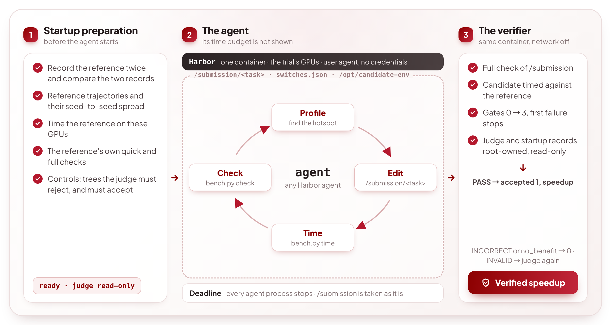

# Eval Protocol

[← Back to README](../README.md#eval-protocol) · [How To Run](how-to-run.md)

Each task fixes an upstream commit, training workload, GPU allocation, numerical gates and timing rules. The agent optimizes the candidate; a frozen judge checks that it performs the same training, faster. Task-specific requirements and thresholds are defined in `tasks/<task>/instruction.md`.

## Tasks and numerical equivalence

| Task | Domain | Upstream | GPUs | Accepted | Docs |
| --- | --- | --- | :---: | --- | --- |
| `llava` |  | [haotian-liu/LLaVA](https://github.com/haotian-liu/LLaVA) @ `c121f04` | 2 | N0, N1 | [notes](llava.md) |
| `yoco` |  | [microsoft/unilm](https://github.com/microsoft/unilm) YOCO @ `f4f7b27a` | 2 | N0, N1 | [notes](yoco.md) |
| `nanochat` |  | [karpathy/nanochat](https://github.com/karpathy/nanochat) @ `92d63d4` | 2 | N0, N1 | [README](../tasks/nanochat/README.md) |
| `bagel_sft` |  | [ByteDance-Seed/Bagel](https://github.com/ByteDance-Seed/Bagel) @ `a2fa77d` | 4 | N0, N1 | [notes](bagel_sft.md) |
| `r3` |  | [sen-ye/R3](https://github.com/sen-ye/R3) @ `761b0b0` | 4 | N0 only | [README](../tasks/r3/README.md) |
| `gaussian_splatting` |  | [graphdeco-inria/gaussian-splatting](https://github.com/graphdeco-inria/gaussian-splatting) @ `54c035f` | 1 | N1 only | [README](../tasks/gaussian_splatting/README.md) |
| `slime_grpo` |  | [THUDM/slime](https://github.com/THUDM/slime) @ `540ea919` | 4 | N1 | [notes](slime_grpo.md) |
| `slime_opd` |  | [THUDM/slime](https://github.com/THUDM/slime) @ `540ea919` | 4 | N1 | [notes](slime_opd.md) |

N0 = the candidate's deterministic records are bit for bit the reference's (same dtypes and math modes); N1 = not
bitwise, but every exact item identical and the candidate statistically equivalent to the reference (its trajectory on
a frozen seed within 3 × the reference's own seed-to-seed spread, where `bagel_sft` measures a second frozen seed when
the first is beyond that; for the RL tasks also the update-direction and second-moment gates of the training side,
token forcing of the rollout and, for `slime_opd`, the teacher replay).
`llava` and `yoco` also accept local precision changes (TF32, lower-precision reductions, another attention backend):
such a candidate is never N0, its check result lists the change (`precision_changed`), and the statistical gate
decides as for any other N1 candidate. Each task's instruction states which precision changes it accepts.

## Overall score

For the preview leaderboard, each task's accepted speedup is normalized as `ln(speedup) / ln(best speedup on that task)`: 0 for no speedup, 1 for the best result on that task. The Overall score fits all 64 normalized values the way the [Epoch Capabilities Index](https://epoch.ai/data/eci-documentation) (ECI) does: each model has one capability `C`, each task a difficulty `D` and a slope `α`, and a normalized value is modelled as `sigmoid(α · (C − D))`, fitted by least squares with an L2 penalty (λ = 0.1). The capabilities are then mapped linearly so that Claude Opus 5.5 = 40 and Kimi k3.1-pro = 10; a task's difficulty sits on the same scale. Unlike a plain mean, the fit weights each task by how well it separates models of similar capability. The table displays rounded speedups; normalization uses the underlying measurements. This relative score depends on the other results in the leaderboard and is distinct from the verifier's `accepted` / `speedup` reward.

## Startup preparation

Before the agent starts, the container runs the judge on the unchanged reference on the trial's GPUs: reference
records (twice, compared with each other), the reference trajectories and their seed-to-seed spread, the timing
baseline, the reference's own quick and full checks, and acceptance controls (trees the judge must reject and trees it
must accept). Only then does the trial report ready. This happens in every trial, outside the agent's time, and takes
from about 1.5 hours to about 7 hours depending on the task (see [expected durations](how-to-run.md#expected-durations)).

A **preparation pack** saves most of that on later trials: `scripts/make_prep_pack.py` makes one from a workspace whose
full preparation passed; a trial restores it only when the task, world size, judge workspace hash, GPU model and
installed packages match, then still records and times its own reference. Packs are hardware-specific and none are
shipped: your first trial of each task runs the full preparation. Where a task's Compose file mounts
`tasks/<task>/prep-pack/`, put the pack there; the other tasks read it from `<assets root>/<task>/pack/` (see the
task's README).

## The agent's environment and rules

- The agent runs as the unprivileged user `agent`, with internet access but no credentials in the container (checked
  at startup), and a time budget it is not told: when it ends, every process the agent started is stopped and the
  final evaluation runs on what is in `/submission` at that moment.
- It edits `/submission/<task>`, may set environment switches in `/submission/switches.json`, and may install anything
  into its own environment `/opt/candidate-env`. The judge, its Python (the image's training environment) and the
  startup measurements are root-owned and read-only.
- The verifier runs the judge's full check in the same container, as `agent`, with the network switched off.
- Task-specific rules are in each `instruction.md`. Among them: published optimized versions of these workloads are
  off limits (each task README gives the log search that audits it); the two slime tasks forbid speculative decoding
  (the checkpoint's MTP head, EAGLE, n-gram drafts); and no task may skip, shorten or reorder computation depending on
  the *values* of a step's rewards, advantages, losses or samples (work the recipe's configuration makes dead
  regardless of the data, such as a term whose coefficient is 0, may still be removed).

## Verdict and timing

The verdict (`check.json` of the verifier's full check) becomes the reward:

| Full check | `accepted` | `speedup` |
| --- | --- | --- |
| PASS (bitwise or statistically equivalent, faster than the bar) | 1 | `performance.speedup` |
| INCORRECT, or UNAVAILABLE / no_benefit | 0 | 0 |
| ERROR the candidate caused (changed setup, candidate run failed after the reference ran, invalid `switches.json`) | 0 | 0 |
| any other ERROR or INVALID | no reward: an infrastructure problem, inspect the logs and judge again | |

**Timing.** Each judge times fixed windows of optimizer steps after a warmup (the slime tasks also run an untimed
priming run, so that shape-dependent Triton autotuning and compilation stay outside the timed windows). The final
evaluation times reference → candidate → reference in the same container, except in the two slime tasks:

- `nanochat`, `r3`: per window, ratio = reference / candidate; **speedup = the mean of the window ratios**. INVALID
  when the two reference runs differ in a window by more than the task's band (5%; `r3` 15%).
- `slime_grpo`, `slime_opd`: only the candidate is timed, against the reference that the startup preparation measured
  on the same GPUs (per window, the mean of three reference runs); per window, ratio = reference / candidate;
  **speedup = the mean of the window ratios**. INVALID when that reference was measured on other GPUs, or when the
  machine is busy as the timed run starts.
- `llava`, `yoco`, `bagel_sft`: speedup = the reference's mean step time / the candidate's; INVALID when a run's
  windows spread by more than 6% ((max − min) / mean), a sign of interference.
- `gaussian_splatting`: whole runs; speedup = mean(reference A, reference B) / candidate; INVALID above a 5% spread
  between the two reference runs.

A speedup must also clear the task's bar (in `instruction.md`; typically 1.02, or one plus twice the reference's own
spread, the larger) to count; below it the check is UNAVAILABLE (no_benefit) and no numerics are evaluated.
